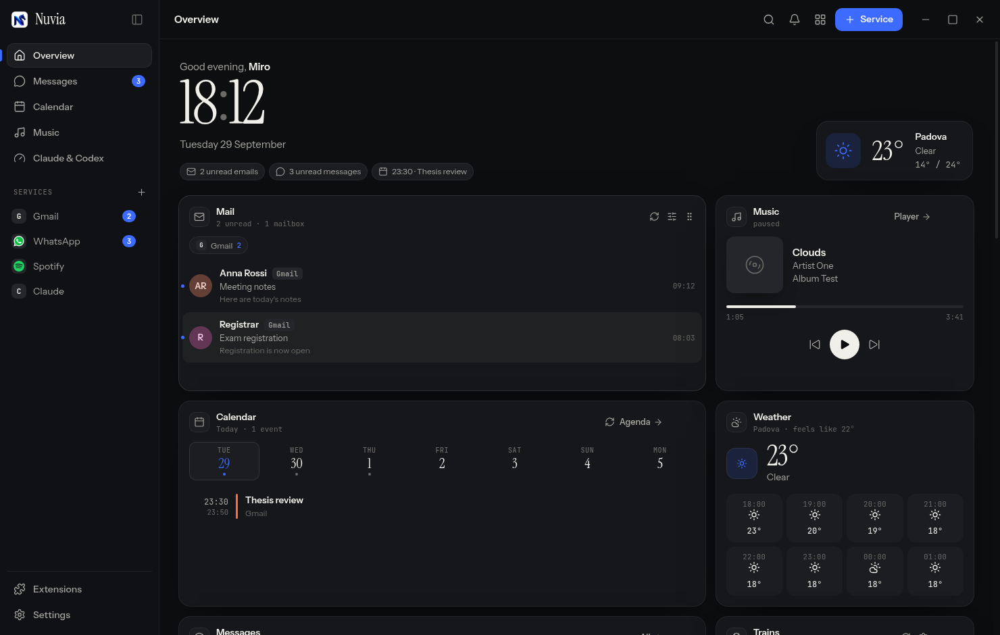
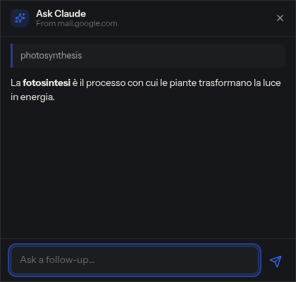
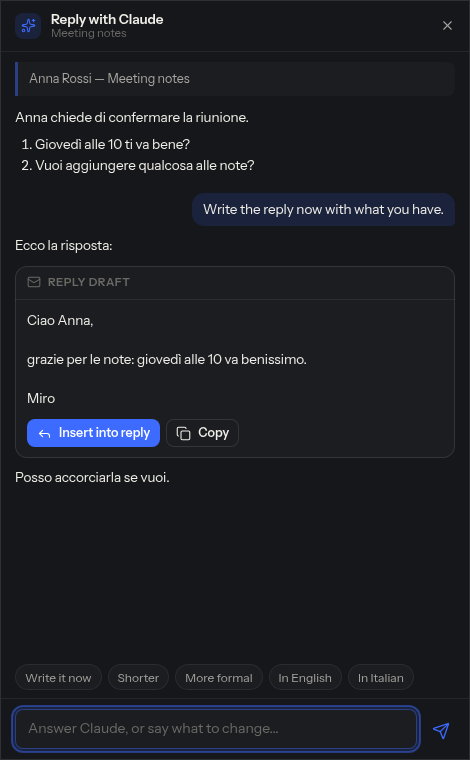
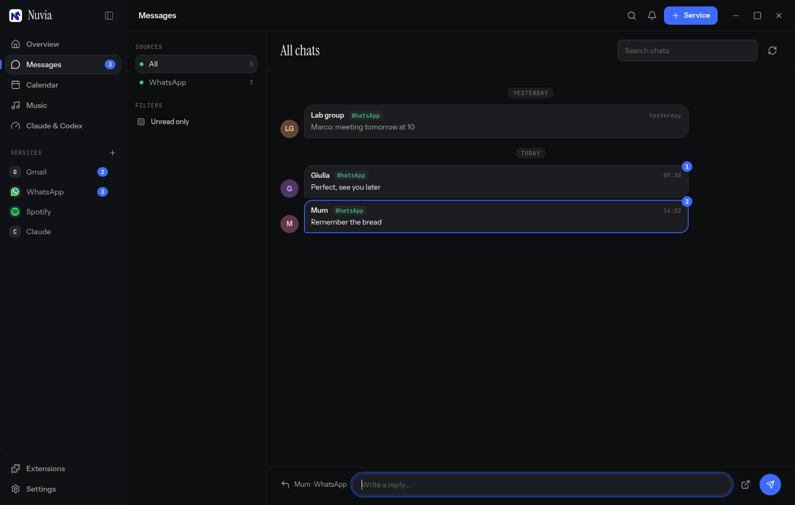
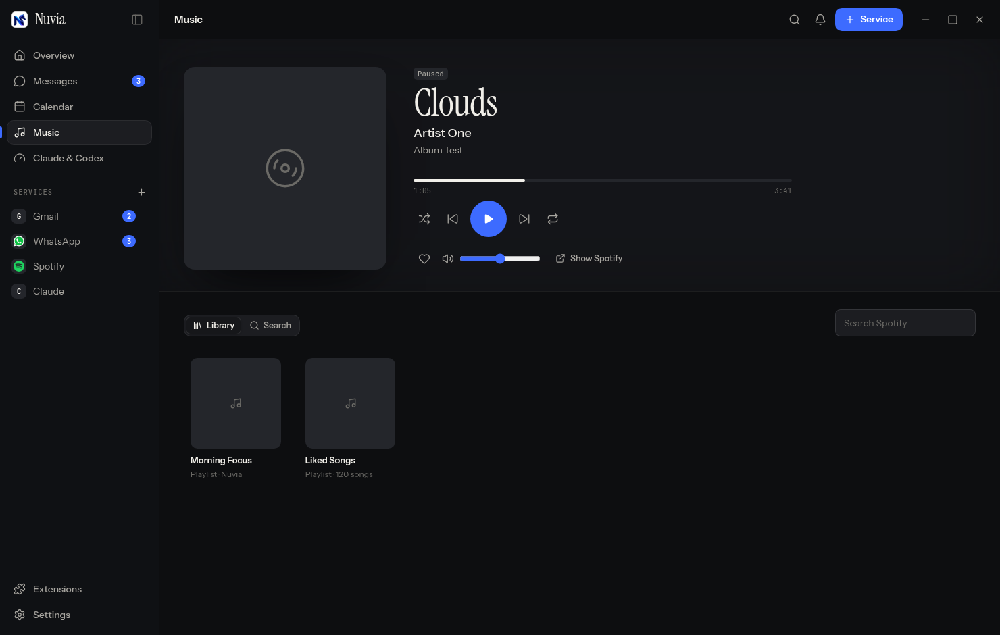
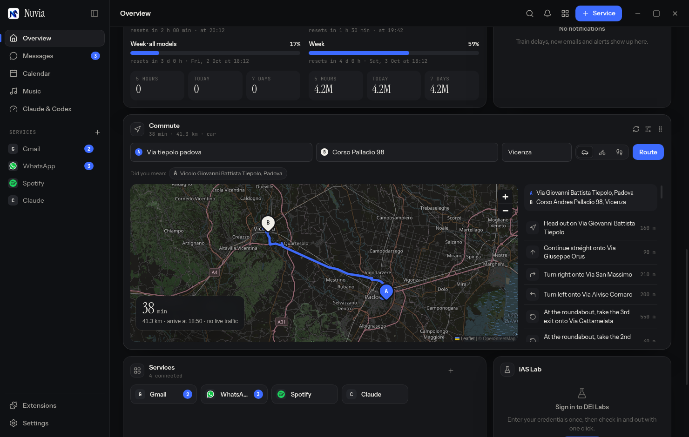
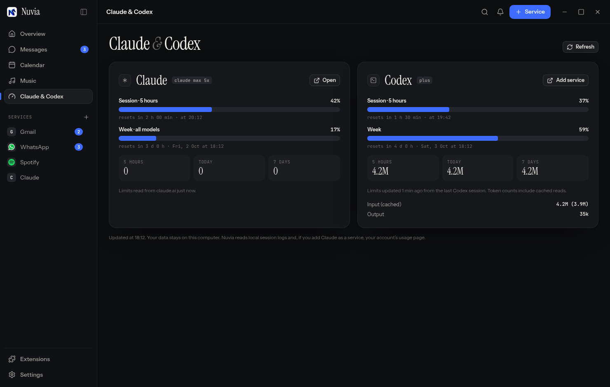

<p align="center"></p>

<h1 align="center">Nuvia</h1>

<p align="center">All your web apps in one window: mail, chats, calendar, music and more, with sessions that stay signed in.<br>
Windows · macOS · Linux</p>

<p align="center"><a href="https://github.com/mirovix/nuvia/releases/latest"><b>Download the latest release</b></a></p>



Nuvia runs Gmail, Outlook, WhatsApp, Telegram, Mattermost, Spotify, Notion, Claude, Codex and any other website side by side. Each one lives in its own persistent profile, so you sign in once. A customizable overview brings together new mail, your agenda, every chat, what's playing and your commute.

## Claude and ChatGPT, right where you work

Nuvia puts your own Claude or ChatGPT account to work inside every app, without switching windows.

- **Ask about anything you select.** Select a word, a sentence or an error message on any page, right-click, *Ask Claude about "…"*. A small window opens next to the mouse and says what it is; ask a follow-up or click away to close it.
- **Reply to an email with AI.** With an email open in Gmail or Outlook, click **Reply with Claude** in the top bar. It reads the thread, tells you what the sender wants, asks what you want to answer, then writes the reply in the email's own language. *Insert into reply* puts it straight into the reply box; *Shorter*, *More formal* or anything you type changes it.
- **Reply to a chat with AI.** The same button in WhatsApp, Telegram, Teams, Mattermost and Slack: it reads the open conversation (knowing which messages are yours) and drafts the next message in its language and tone. *Put in the chat* writes it in the message box without sending it.
- **Claude or ChatGPT: you choose** in Settings → General. Claude answers through Claude Code, ChatGPT through the Codex CLI, signed in to your own accounts on your computer. With several ChatGPT accounts, one at its usage limit hands over to the next.
- **See what's left.** The *Claude & Codex* page and the overview card show the 5-hour and weekly limits left on every account, and when they reset.

| | |
| --- | --- |
|  |  |

Nothing is sent anywhere until you ask and conversations are not saved. *Ask* can search the web for anything recent; *Reply* works on the email alone. Neither can run commands or read your files. Details in [Privacy](#privacy).

## Download

Every build is on the **[Releases page](https://github.com/mirovix/nuvia/releases/latest)**.

| System | File | Notes |
| --- | --- | --- |
| Windows 10 / 11 (64-bit) | `Nuvia-Setup-<version>.exe` | Installer. `Nuvia-<version>-portable.exe` runs without installing. |
| macOS, Apple Silicon (M1–M4) | `Nuvia-<version>-mac-arm64.dmg` | |
| macOS, Intel | `Nuvia-<version>-mac-x64.dmg` | |
| Ubuntu / Debian / Mint | `Nuvia-<version>-amd64.deb` | |
| Fedora / openSUSE / RHEL | `Nuvia-<version>-x86_64.rpm` | |
| Any Linux | `Nuvia-<version>-x86_64.AppImage` | No install needed. |

`SHA256SUMS.txt` lists the checksums of every file.

## Install

### Windows

1. Download and run `Nuvia-Setup-<version>.exe`.
2. The app isn't code-signed yet, so SmartScreen may say "Windows protected your PC". Click **More info → Run anyway**.
3. Nuvia appears in the Start menu and on the desktop.

### macOS

1. Open the `.dmg` for your Mac and drag **Nuvia** into **Applications**.
2. The app isn't notarized by Apple yet. The first time, right-click it and choose **Open → Open**. If macOS says the app "is damaged", clear the quarantine flag:

   ```bash
   xattr -dr com.apple.quarantine /Applications/Nuvia.app
   ```

### Linux

**Ubuntu / Debian**

```bash
sudo apt install ./Nuvia-<version>-amd64.deb
```

**Fedora / RHEL**

```bash
sudo dnf install ./Nuvia-<version>-x86_64.rpm
```

**AppImage (any distribution)**

```bash
chmod +x Nuvia-<version>-x86_64.AppImage
./Nuvia-<version>-x86_64.AppImage
```

On Ubuntu 22.04 and later the AppImage needs `libfuse2` (`sudo apt install libfuse2`).

**Any distribution, no root (`.tar.gz`)**

```bash
mkdir -p ~/.local/opt && tar -xzf Nuvia-<version>-x64.tar.gz -C ~/.local/opt && mv ~/.local/opt/Nuvia-<version>-x64 ~/.local/opt/Nuvia
~/.local/opt/Nuvia/nuvia-desktop
```

### Updates

Install once: after that Nuvia updates itself. Every few hours it checks the
[latest release](https://github.com/mirovix/nuvia/releases/latest); when there is a
new version it downloads it in the background, checks its SHA-256 against
`SHA256SUMS.txt` and installs it the next time you restart Nuvia (or right away
with **Restart now** in the top bar). The previous version is kept next to it
(`Nuvia.old`) in case you need to go back.

| Install | Updates |
| --- | --- |
| Windows installer, portable `.exe` | automatic |
| macOS `.app` in Applications | automatic |
| Linux AppImage, `.tar.gz` folder | automatic |
| Linux `.deb` / `.rpm` | Nuvia tells you and opens the download (the system owns those files) |

Turn it off in **Settings → General → Update automatically**; check by hand in **Settings → About**.

## Features

- **Overview** made of widgets you can show, reorder (drag them by the handle), resize and configure one by one.
- **Mail**: previews of new Gmail and Outlook messages; one click opens the thread.
- **Messages**: WhatsApp, Telegram, Mattermost and Microsoft Teams in a single timeline that reads like one chat, with quick replies. Teams keeps its Microsoft sign-in inside Nuvia and can share your screen.
- **Calendar**: one agenda from Google Calendar, Outlook and any iCal link. The same appointment booked hour by hour (a 9–10 and a 10–11 lecture) shows as one 9–11 event.
- **Music**: a built-in player on top of Spotify Web, with artwork, artist, album, progress, volume, library and search. It never opens the Spotify app.
- **Stays signed in**: services that sign you out every few hours (a university Google Workspace, Microsoft 365) sign back in by themselves after you log in once, including single-sign-on pages with a domain picker such as the University of Padova's (@unipd.it, @studenti.unipd.it); you get a notification when a second factor is needed, and a password that is refused is tried at most twice. Sign-in pages get no passkeys, so Microsoft and Google ask for your password instead of face, fingerprint or PIN. Chromium's tracker cleanup, which deleted single-sign-on sessions about once a day, is off.
- **Commute**: route from A to B on a map, turn-by-turn directions, by car, bike or on foot. Addresses are checked against the city you typed. Map tiles are cached on disk and fetched as OpenStreetMap's tile policy asks, with backup map servers if one refuses.
- **Live traffic** (optional): add a free TomTom key in Settings → Integrations and the commute shows the real delay and arrival time instead of free-flow. Without a key the card says *no live traffic · add a free key*, which opens that setting; it never guesses.
- **Right click** works on every page: copy, paste, links, images, spelling, back and reload.
- **Ask Claude**: select some text anywhere, right-click, *Ask Claude about "…"*. A small window next to the mouse says what it is, without leaving the page; you can ask a follow-up, and a click elsewhere closes it.
- **Reply with Claude** (or ChatGPT): with an email open in Gmail or Outlook, click *Reply with Claude* in the top bar (or right-click the email). Claude reads the thread, says what the sender wants, asks what you want to answer, then drafts the reply; *Insert into reply* puts it into the email's reply box, or *Copy* it. Ask for changes (*Shorter*, *More formal*, or anything you type) until it is right. In a chat app (WhatsApp, Telegram, Teams, Mattermost, Slack), it drafts the next message of the open conversation straight away, and *Put in the chat* writes it in the message box, unsent.
- **Claude & Codex**: how much of the 5-hour and weekly limits you've used, when they reset, and how many tokens you've spent.
- **Notifications** that go away once read (clicked, the service opened, or seen in the panel), and only for the cards you show on the overview. **Weather** with feels-like, humidity, wind, rain, UV, sunrise and sunset, the next 12 hours and 5 days. Italian **trains** (ViaggiaTreno, with delay alerts) and **Notion** shortcuts. The music card closes after two minutes of pause.
- Chrome Web Store **extensions**, enabled per service.
- Dark, light or system theme, seven accent colours, backgrounds and a compact sidebar.
- **Time zone**: pick the one you are in (Settings → General); the clock, calendar, mail and message times follow it at once.
- Shortcuts: `Ctrl/⌘+1…9` services, `Ctrl/⌘+0` overview, `Ctrl/⌘+K` go to…, `Ctrl/⌘+R` reload, `Ctrl/⌘+,` settings.

| | |
| --- | --- |
|  |  |
|  |  |

## Privacy

- **Stay signed in** (on by default, Settings → General): when you sign in on a service's sign-in page (Google, a university single sign-on, Microsoft), Nuvia keeps that email and password encrypted with the system keychain and uses them only to sign that service back in when its session expires. Nothing is stored on any other page, and you can remove the saved sign-in per service in Edit service. Otherwise each login stays in a local Chromium profile on your computer.
- Session-only cookies (for example a university single sign-on) are kept across restarts, encrypted with the system keychain, like Chrome does when it reopens your tabs.
- Mail and chat previews, the agenda and the player state are read from the service pages already open in Nuvia. Nothing goes through a third-party server.
- **Claude & Codex** reads the local session logs of Claude Code (`~/.claude`) and Codex (`~/.codex`). No credentials are read.
  - *Codex* limits are asked live from the Codex CLI (`codex app-server`), one set of bars per account, and shown like Codex shows them: what is **left** in each window (5 hours, week, or month on the free plan). Codex keeps one login per folder: sign in another account once with `CODEX_HOME=~/.codex-work codex login` and every `~/.codex-*` folder shows up on its own.
  - *Claude* limits come from your claude.ai usage page if you add Claude as a service, otherwise from the copy Claude Code keeps of them in `~/.claude.json` (refreshed while it runs, in the terminal or in VS Code; only that entry is read). For the terminal, **Show limits from Claude Code** can also add a status line that prints `5h 23% · 7d 41%`; it never replaces a status line you already have and keeps a backup of `settings.json`.
- **Claude or ChatGPT** (Settings → General → *Ask and Reply with*): ChatGPT answers through the Codex CLI's app server (`codex app-server`), which streams the answer and stays open for the conversation. The thread is ephemeral and read-only, never asks for approval, and every Codex feature that could act instead of talk is turned off (commands, browser and computer use, plugins, apps, hooks, MCP servers): an email is untrusted text, and with its tools on, a read-only Codex still lists your files when asked to. *Ask* keeps Codex's live web search, which runs in its code-mode host, a JavaScript runtime with no file system; *Reply* has no web search either. When an account signed in to Codex is at its usage limit, the next one (`~/.codex-*`) answers, with the conversation so far.
- **Ask Claude** and **Reply with Claude** use the Claude Code CLI installed on your computer (`claude`, signed in to your account), started with no MCP servers and none of your Claude Code settings or hooks, and with no tools but web search and fetch for *Ask* (none for *Reply*): it cannot run commands or read files. The selected text, or the open email thread, goes to Claude only when you ask; conversations are not saved. Claude talks in your system's language (Italian on an English desktop with Italian dates), and replies in the email's own language. Without Claude Code, the question is copied for you to paste into Claude.
- Extensions are never loaded into Nuvia's own interface, only into the services where you enable them.

## Extensions

Search the Chrome Web Store from **Extensions** and install with one click. By default an extension is enabled only on the services it targets (Streak, for example, only on Gmail), and you can switch it on or off per service.

Electron supports a subset of the Chrome extension APIs. Nuvia fills in the ones an extension's background needs to start (`permissions`, `alarms`, `webNavigation`, `windows`…) and `chrome.extension` in its content scripts, so extensions like Streak and AdBlock run; their sign-in windows open inside the service, and an extension's toolbar menu works on the page it was opened from. If an extension crashes Nuvia, or crashes a service repeatedly, Nuvia disables it on that service and tells you.

**Streak** stays signed in: connect it once and reloads and restarts keep it connected. (Electron leaves `chrome.extension` out of extension content scripts, and Streak saves its sign-in only when that exists; Nuvia adds it.) If its sign-in ever expires, Nuvia signs it back in by itself in a hidden window, which shows only if it needs you (a new password, a second factor).

**AdBlock** starts and its menu works, but Electron does not apply its blocking rules: it blocks nothing for now.

## Integrations

Two optional integrations for the University of Padova, both configured in **Settings → Integrations**:

- **IAS Lab (DEI Labs)**: check in to and out of a DEI lab with one click. Nuvia asks for your DEI credentials once, keeps the session and stores the password encrypted in the system keychain. Based on [log_ias_lab](https://github.com/mirovix/log_ias_lab).
- **Trains (Ritardometro)**: live departures from your station towards the destinations you pick, plus a notification when a watched train is late. The first configuration is imported from [ritardometro](https://github.com/mirovix/ritardometro).

## Notes

- **Spotify and DRM**: Nuvia is built on [Electron for Content Security](https://github.com/castlabs/electron-releases) by castlabs, which ships Widevine. On Windows and macOS some streaming services also require castlabs VMP signing to play protected content. The published builds aren't VMP-signed, so playback may not start on those systems.
- **App data** lives in `%APPDATA%\nuvia-desktop` (Windows), `~/Library/Application Support/nuvia-desktop` (macOS) and `~/.config/nuvia-desktop` (Linux).

## Development

You need Node.js 22 and git.

```bash
git clone https://github.com/mirovix/nuvia.git
cd nuvia
npm install
npm start
```

### Tests

```bash
npm test                  # unit: addresses, routing, iCal, parsers, usage, extensions
npm run test:ui           # end-to-end on every page and button, with simulated services (Linux + xvfb)
npm run test:chat         # right click, Ask Claude, Reply with Claude (a fake Claude Code)
npm run test:calendar     # Google Calendar exported from the page when the direct download fails
npm run test:integration  # against the real services: network, Chrome Web Store, Spotify DRM, WhatsApp
```

### Packages

```bash
npm run pack:linux   # AppImage, deb, rpm, tar.gz
npm run pack:win     # NSIS installer and portable exe
npm run pack:mac     # dmg and zip (macOS only)
```

### Releasing

Bump `version` in `package.json`, then:

```bash
git tag v0.6.0
git push origin v0.6.0
```

The [Release workflow](.github/workflows/release.yml) builds on Linux, Windows and macOS and publishes every file to a new GitHub Release.

Windows and macOS builds are **VMP-signed** with [castlabs EVS](https://github.com/castlabs/electron-releases/wiki/EVS): without it, Widevine refuses Spotify's licences and playback stops after a few seconds. Set it up once with `bash scripts/setup-vmp-signing.sh`: it creates the free EVS account, checks it, and stores its name and password as the repository secrets `EVS_ACCOUNT_NAME` and `EVS_PASSWD`; the release workflow then signs and verifies every package. Without the secrets it still builds, unsigned, with a warning.

## Credits

[Electron](https://www.electronjs.org/) (castlabs ECS build), [Leaflet](https://leafletjs.com/) and © [OpenStreetMap](https://www.openstreetmap.org/copyright) contributors, [Nominatim](https://nominatim.org/) geocoding, [OSRM](https://project-osrm.org/) routing on FOSSGIS servers, [Open-Meteo](https://open-meteo.com/) weather, [Lucide](https://lucide.dev/) icons (ISC), Instrument Sans, Instrument Serif and JetBrains Mono fonts (SIL OFL). Details in [THIRD_PARTY.md](THIRD_PARTY.md).
